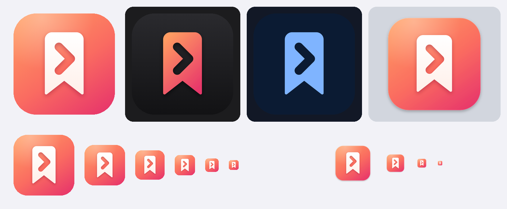

# Nextmark app icon — "Next Ribbon"



A bookmark ribbon with a forward chevron cut out of it: *a saved thing that
knows its next step*. One silhouette with negative space, so it survives every
size and every appearance (light, dark, tinted, and the Liquid Glass treatment).

| | |
|---|---|
| Background | Coral gradient `#FF9B62` → `#FA6B61` → `#E8386A`, soft top-left sheen |
| Glyph | Warm white ribbon (`#FFFFFF` → `#FFF0EA`), chevron knocked out to the background |
| Accent | `#FA6B61`, also the app's `AccentColor` |
| Dark | Coral ribbon on near-black; tinted: white ribbon on black (system tints by luminance) |
| macOS | Own rounded square on the 824/1024 grid with a drop shadow (macOS doesn't mask icons) |

## Files

- `make_icon.py` — single source of truth for geometry and colours; writes `masters/*.svg`.
- `masters/` — SVG masters for every variant, plus `Layer-1-Background.svg` and
  `Layer-2-Glyph.svg` for **Icon Composer** (Xcode 26) if you want the layered
  Liquid Glass `.icon` format later.
- `render.js` — renders an SVG to PNG with headless Chromium (Playwright).
- `concepts/` — the alternatives considered: B "Done Ribbon" (bookmark + check)
  and C "Comeback" (bookmark in a returning arc).
- The shipped PNGs live in `App/Shared/Assets.xcassets/AppIcon.appiconset`.

## Regenerate

```sh
python3 Design/AppIcon/make_icon.py
cd Design/AppIcon
node render.js /tmp/icon 1024 opaque masters/AppIcon-iOS*.svg
node render.js /tmp/icon 1024 transparent masters/AppIcon-macOS.svg
# then copy into the appiconset: iOS PNGs flattened to RGB (no alpha);
# macOS sizes 16–1024 downscaled from AppIcon-macOS.png (names in Contents.json)
```

`render.js` needs Node with the `playwright` package and a Chromium build.
