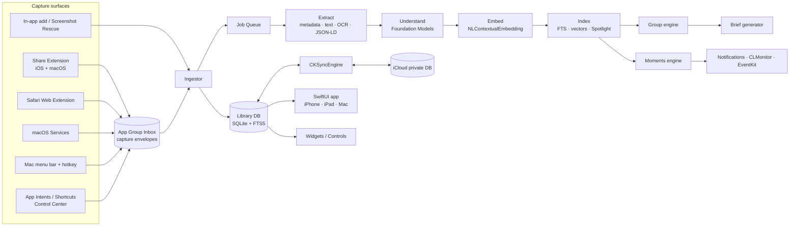
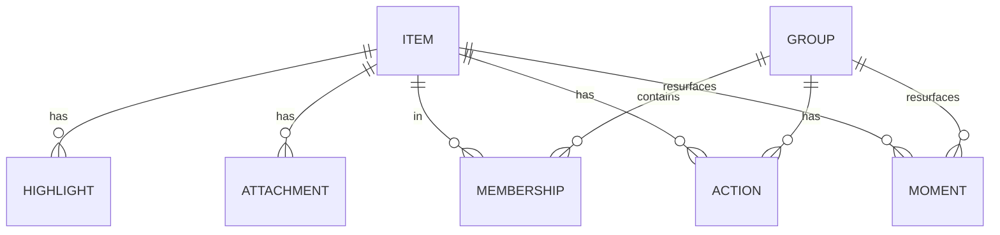
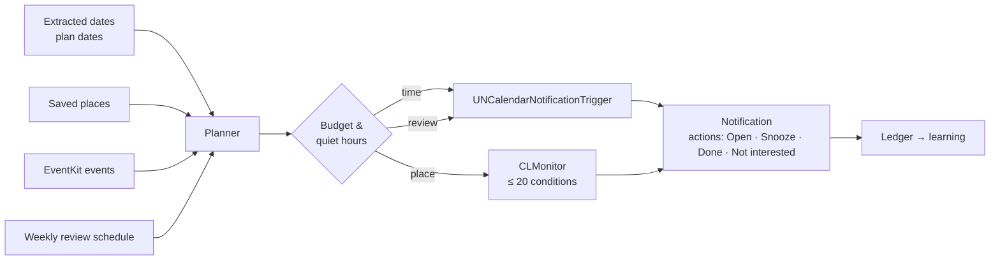

# Intelimark — Architecture

*Working name — see `product_strategy.md` §6.* Requirement IDs (C1, U2, M3…)
refer to `prd.md`.

Goals:
- capture must be **instant and crash-proof**, even when the main app isn't
  running
- all intelligence is **on-device first**, behind protocols, and degrades
  gracefully
- **no server of ours**: CloudKit for sync, Apple models for AI
- one SwiftUI codebase for iPhone, iPad and Mac; extensions stay small
- every AI output is **re-generatable** (versioned pipeline), and user edits
  are never overwritten

AI-session capture, digests, workstreams and Recap are specified in
`ai_sessions_spec.md`. The additions below (§4.2 and §5.1) are reserved in
1.0 so that work is purely additive.

Platform baseline: iOS / iPadOS / macOS 26, Swift 6 (strict concurrency),
SwiftUI, Swift Testing. OS 27 features are behind `#available`.

---

## 1. System overview



The architecture rests on three ideas:

1. **Capture is decoupled from processing.** Every capture surface writes an
   immutable *capture envelope* to the App Group container and exits. Only
   the main app (or its background tasks) touches the database and the AI.
2. **Enrichment is a persistent, versioned job pipeline.** Each stage is
   idempotent and records the version that produced its output. That lets
   us re-run stages when a model or prompt improves, resume after the app is
   killed, and let any device do the work.
3. **Source facts and derived data are separate, and user edits are a
   third layer.** Sync carries all three; precedence is
   `user > derived > source`.

---

## 2. Targets

| Target | Platforms | Purpose | Links |
|---|---|---|---|
| **App** | iOS, iPadOS, macOS | Main UI, ingestor, enrichment, sync, Moments, MenuBarExtra (Mac), Services provider (Mac) | all packages |
| **ShareExtension** | iOS, macOS | C1, C3: intent chips, note, group picker → envelope | `Model`, `Capture`, `CaptureUI` |
| **SafariExtension** | iOS, macOS | C2/C7: JS content script and native handler → envelope; highlight re-render | `Model`, `Capture` |
| **WidgetsExtension** | iOS, macOS | Next Actions widgets, Control Center control (C10, A4) | `Model`, `LibraryRead` |
| **Tests** | all | unit, integration, prompt evals | — |

Mac-only capabilities (Services, menu bar, hotkey, ScreenCaptureKit, `message://`
drag) live in the App target behind `#if os(macOS)`. There's no separate
helper app: the app can run as a menu-bar-only agent ("Keep in menu bar"
setting) and offers *Launch at Login* through `SMAppService.mainApp`.

**Why the share extension doesn't run AI:** iOS share extensions have a tight
memory ceiling (about 120 MB) and the user is waiting. Loading a language
model there risks a jetsam kill, which means a lost save. The extension's
job is to **persist the envelope in under a second** and dismiss.

---

## 3. Capture

### 3.1 Capture envelope

One directory per capture in `AppGroup/Inbox/<ULID>/`:

```
envelope.json      // CaptureEnvelope (below), written last = commit marker
payload/           // raw files: image, PDF, webarchive, .eml, …
```

```swift
struct CaptureEnvelope: Codable, Sendable {
    var id: ULID                       // time-sortable
    var capturedAt: Date
    var device: DeviceID
    var surface: CaptureSurface        // .shareSheet, .safariExtension, .services, .hotkey, .intent, .inApp
    var sourceApp: String?             // bundle id when known
    var url: URL?                      // canonical page / file URL
    var title: String?
    var selection: SelectionAnchor?    // §3.3
    var text: String?                  // selected or shared text
    var pageContext: PageContext?      // lang, JSON-LD blobs, excerpt (Safari)
    var payloadFiles: [PayloadFile]    // relative paths + UTType
    var userIntent: Intent?            // chip tapped in the share UI
    var userNote: String?
    var userGroupID: GroupID?
}
```

Writing `envelope.json` last (atomic rename) makes the operation
crash-safe: the ingestor ignores directories without it and garbage-collects
them after 24 h. The extension posts a Darwin notification so a running app
ingests immediately; otherwise ingestion happens on the next launch,
foreground, or background task.

### 3.2 Surfaces → envelope

| Surface | How | Notes |
|---|---|---|
| Share extension (iOS/macOS) | `NSExtensionActivationRule` predicate for URL, image, text, PDF, file; `NSItemProvider.loadFileRepresentation` to copy files into the payload. | SwiftUI UI hosted in `UIHostingController` / `NSHostingController`. Group picker reads a small `groups.json` snapshot the app writes into the App Group (no DB access from the extension). |
| Safari via share sheet | `NSExtensionJavaScriptPreprocessingFile`: `run()` returns the URL, title, `getSelection()` with prefix/suffix, `lang`, `<script type="application/ld+json">` blobs, and a readable excerpt. | Safari only. Other browsers only provide a URL, and enrichment fetches the page later. |
| Safari Web Extension | Content script for selection UI and highlight re-render; `browser.runtime.sendNativeMessage` → `SafariWebExtensionHandler` writes the envelope. A `contextMenus` item gives a top-level right-click entry on Mac. | The highlight list for a page is read from a per-domain JSON index the app writes into the App Group. |
| macOS Services | `NSServices` entry in Info.plist (`NSSendTypes: public.utf8-plain-text, public.url, public.file-url`), handled by `NSApp.servicesProvider`. | Launches the app if needed. |
| Mac quick capture | `MenuBarExtra` and a hotkey via `RegisterEventHotKey` (sandbox-safe). Sources: pasteboard, the frontmost Safari tab (asked from the Safari Web Extension over native messaging; Apple Events to Safari would need a temporary-exception entitlement that App Review resists), and screenshots via `SCScreenshotManager`. | Screen Recording permission is requested only when the user first chooses "Capture screenshot". |
| Mail (Mac) | Dropping a message from Mail yields a `message://%3CMessage-ID%3E` URL plus a `.eml` file promise. | Reopens the exact message. |
| App Intents | `SaveItemIntent(url:text:file:intent:)`, `SaveClipboardIntent`, `SaveLatestScreenshotIntent`; a Control Center `ControlWidgetButton`. | Same envelope path, so behaviour is identical everywhere. |
| Screenshot Rescue | `PHAsset` fetch from `.smartAlbumScreenshots`; bulk import runs as a `BGContinuedProcessingTask` (iOS 26) with system progress UI. Stores `PHAsset.localIdentifier` to offer "delete from Photos" later. | Imports go straight to the ingestor (no envelope), in batches of 50. |

### 3.3 Anchors: returning to the exact place (F5)

```swift
enum SelectionAnchor: Codable, Sendable {
    case web(textFragmentURL: URL,              // url#:~:text=prefix-,start,end,-suffix
             quote: TextQuote)                  // W3C TextQuoteSelector: exact + prefix + suffix
    case pdf(page: Int, quote: TextQuote, bounds: [CGRect])
    case mail(messageURL: URL)                  // message://<id>  (Mac)
    case file(bookmark: Data, quote: TextQuote?) // security-scoped bookmark (Mac) / copy (iOS)
    case image(region: CGRect?)                 // optional crop of interest
}
```

The text-fragment URL is used to *open* the page. The `TextQuote` is used to
*re-anchor* highlights in the Safari extension when the page has changed
slightly (fuzzy match on prefix and suffix).

---

## 4. Data model

### 4.1 Storage choice: SQLite (GRDB) + CKSyncEngine, not SwiftData

| Need | SwiftData + CloudKit | **GRDB + CKSyncEngine** |
|---|---|---|
| Full-text search with ranking | ✗ (`#Predicate` `contains` only) | ✓ FTS5 + BM25 |
| Vector storage and fast scans | awkward | ✓ BLOB column + Accelerate |
| Unique constraints, dedupe | ✗ under CloudKit | ✓ |
| Control over conflicts and sync scope | ✗ | ✓ per-record, per-field |
| Shared zones later (G7) | ✗ | ✓ CKShare per group zone |
| Effort | low | medium (≈1–2 weeks extra) |

`CKSyncEngine` (iOS 17+ / macOS 14+) handles scheduling, push, retries and
account changes. We map rows ⇄ `CKRecord`.

### 4.2 Entities



**Item** (synced)
- Identity: `id`, `kind`, `createdAt`, `capturedOn`, `surface`, `sourceApp`, `canonicalURL`, `contentHash`
- **Source facts:** `sourceTitle`, `text`, `anchor`, `pageContextJSON`
- **Derived** (AI and extractors, each with `derivedVersion`): `aiTitle`, `summary`, `imageDescription`, `ocrText`, `kindGuess`, `entitiesJSON`, `typedFieldsJSON` (product/place/event/recipe…), `datesJSON`, `placesJSON`, `suggestedIntent`, `language`
- **User layer:** `userTitle`, `note`, `intent`, `status` (`inbox · active · done · faded · trashed`), `pinned`, `editedFields` (bitset), `lastOpenedAt`

**Highlight**: `itemID`, `anchor`, `quote`, `color`, `note`

**Attachment**: `itemID`, `role` (`original · thumbnail · archive`), `uti`, `byteSize`, `localPath`, `syncPolicy` (`always · ifEnabled · never`)

**Reserved for AI sessions** (`ai_sessions_spec.md` §7): `Item.kind` `.aiSession`, `Item.status` `.log`, `Item.syncScope` (`cloud · local`); `SessionMeta`, `ActivitySpan` (recorded for *every* item from 1.0), `Rollup`, `Recap`; `Group.kind` `.workstream`.

**Group**: `id`, `kind` (`manual · smart · plan · workstream`), `state` (`suggested · accepted · dismissed`), `userTitle`/`aiTitle`, `emoji`, `color`, `goal`, `targetDate`, `briefJSON`, `briefVersion`, `briefInputsHash`, `status`

**Membership**: `groupID`, `itemID`, `origin` (`user · ai`), `score`, `locked`. A membership the user creates or confirms is locked, and the AI never removes it.

**Action**: `id`, `itemID?`, `groupID?`, `title`, `dueAt?`, `status`, `origin` (`user · aiSuggested · aiAccepted`), `reminderID?` (EventKit calendarItemIdentifier, per device)

**Moment**: `id`, `target` (item/group), `trigger` (`date(Date) · place(lat, lon, radius) · calendar(eventID) · review`), `state` (`scheduled · delivered · dismissed · acted`), `deliveredAt`

**Local only (never synced; rebuilt on demand):** `item_fts` (FTS5),
`embedding(itemID, modelID, vector BLOB)`, `group_centroid`, `job`,
`notification_ledger`, `place_monitor_set`.

### 4.3 Sync rules

- One custom zone `Library` in the private database; later, one zone per
  shared group (G7).
- Record fields map 1:1 to the three layers. **Conflict policy:** the user
  layer is last-writer-wins per field (using a modification-time vector).
  For the derived layer the **higher `derivedVersion` wins**, and on a tie
  the later write wins. Source facts are immutable after creation.
- Embeddings aren't synced. They are cheap to recompute, and the embedding
  model can differ between OS versions; `modelID` detects that.
- Attachments: the thumbnail is always a `CKAsset`. The original follows the
  user's "Sync originals" setting. A web archive syncs only on Pro with the
  setting on.
- **Enrichment lease:** before running AI on an item, a device writes
  `enrichLease = (deviceID, expiresAt)` to the record. Other devices skip
  leased items. The work is idempotent, so a lost race only wastes effort.
  Devices with Apple Intelligence advertise `aiCapable` in a small
  `Device` record so devices without it can leave the work to them.

---

## 5. Enrichment pipeline

### 5.1 Job queue

```swift
struct Job { let itemID: ItemID; let stage: Stage; var attempts: Int; var notBefore: Date }
enum Stage: Int, CaseIterable { case extract, prefilter, understand, digest, embed, index, group, moments, rollup }
// prefilter/digest run only for .aiSession; rollup runs per workstream × ISO week (ai_sessions_spec.md §4–5)
```

- Persisted in SQLite; a single `actor PipelineRunner` drains it with
  bounded concurrency (2 for extraction, 1 for the model).
- Runs when: the app is in the foreground; `BGProcessingTask` (overnight,
  charging); `BGAppRefreshTask` (small batches); during
  `BGContinuedProcessingTask` for bulk imports. On the Mac it runs whenever
  the app or menu-bar agent is alive.
- Backs off on `ProcessInfo.thermalState ≥ .serious` and Low Power Mode.
- Each stage writes its outputs plus `derivedVersion`. Raising a stage's
  version in a release re-enqueues affected items lazily (visible items
  first).

### 5.2 Stages

| Stage | Inputs → outputs | Tech |
|---|---|---|
| **Extract** | URL → title, favicon, hero image, canonical URL, readable text, JSON-LD; PDF → text per page; image → OCR text, barcodes, classification labels | `LPMetadataProvider`, `URLSession` + HTML readability parser, `PDFKit`, Vision `RecognizeTextRequest`, `DetectBarcodesRequest`, `ClassifyImageRequest` |
| **Understand** | extracted text and/or image → `ItemUnderstanding` | Foundation Models guided generation (§6) |
| **Embed** | title + summary + note + highlights + OCR (truncated) → vector | `NLContextualEmbedding` (mean-pooled), behind `EmbeddingProvider` |
| **Index** | → FTS5 row, vector row, `CSSearchableItem` + `IndexedEntity` | GRDB, Core Spotlight, App Intents |
| **Group** | vector → suggested membership / suggested new group | §7 |
| **Moments** | dates, places, plan dates → `Moment` rows → OS schedulers | §8 |

### 5.3 Fallback matrix

| Capability | OS 27 + Apple Intelligence | OS 26 + Apple Intelligence | No Apple Intelligence |
|---|---|---|---|
| Image description | on-device model with image `Attachment` | OCR + labels → text model writes the description | OCR + labels (template text) |
| Summary / kind / entities | on-device model | on-device model | schema.org + heuristics; **deferred to an AI-capable device** if the user has one |
| Group naming / Brief | on-device; PCC for large groups | on-device, map-reduce | keyword-based names ("Kyoto · 9 items"); Brief deferred |
| Embeddings / search | ✓ | ✓ | ✓ (`NLContextualEmbedding` doesn't need Apple Intelligence) |

`SystemLanguageModel.default.availability` is checked on every launch.
`modelNotReady` re-queues the work rather than failing it.

---

## 6. Intelligence layer

### 6.1 Interfaces

```swift
protocol ItemUnderstander: Sendable {
    func understand(_ input: UnderstandingInput) async throws -> ItemUnderstanding
}
protocol GroupBriefWriter: Sendable {
    func brief(for group: GroupSnapshot, items: [ItemDigest]) async throws -> GroupBrief
}
protocol EmbeddingProvider: Sendable {
    var modelID: String { get }
    func embed(_ text: String, language: NLLanguage?) async throws -> [Float]
}
protocol QueryInterpreter: Sendable {          // F2 natural-language filters
    func interpret(_ query: String, now: Date) async throws -> SearchQuery
}
```

Implementations: `FoundationModelsUnderstander`, `VisionHeuristicUnderstander`
(fallback), `FakeUnderstander` (tests). The `IntelligenceRouter` picks one per
call from availability, OS version, input size and user settings. The
Foundation Models `LanguageModel` protocol (OS 27) leaves the door open to a
user-supplied cloud model later without changing these interfaces.

### 6.2 Guided generation types

```swift
@Generable struct ItemUnderstanding {
    @Guide(description: "Short, specific title, max 8 words") var title: String
    @Guide(description: "1–2 sentences: what it is and why it might matter") var summary: String
    var kind: ItemKind                      // @Generable enum
    @Guide(description: "Why a person most likely saved this") var likelyIntent: Intent
    @Guide(.maximumCount(8)) var keywords: [String]
    @Guide(.maximumCount(5)) var dates: [ExtractedDate]     // what + ISO date + role (start/deadline/expiry)
    @Guide(.maximumCount(5)) var places: [ExtractedPlace]   // name + address text
    var product: ProductFields?
    var event: EventFields?
    var recipe: RecipeFields?
}

@Generable struct GroupBrief {
    var title: String
    var overview: String
    @Guide(.maximumCount(5)) var keyPoints: [String]
    @Guide(.maximumCount(3)) var openQuestions: [String]
    @Guide(.maximumCount(4)) var suggestedActions: [SuggestedAction]
}
```

Rules:
- **Facts from structure first.** schema.org data (prices, dates, addresses)
  fills typed fields deterministically; the model only fills gaps, and
  model-produced dates are validated against the source text before they can
  create a Moment.
- **Small, narrow prompts.** One session per task and no long chats, to stay
  well inside the **8,192-token on-device context**. The token-count API
  (26.4+) is used to truncate inputs deterministically.
- **Map-reduce for Briefs.** Item digests are about 60 tokens each (title,
  summary, typed fields). A group under roughly 80 items fits on-device in one
  pass. Larger groups are chunked, or sent to **Private Cloud Compute**
  (32K context) on OS 27, which is free to developers below 2M first-time
  downloads, with no keys and no stored prompts.
- **Brief regeneration** happens only when `briefInputsHash` (sorted member
  IDs + their `derivedVersion`) changes, debounced by 10 minutes.
- **Guardrail errors** (`guardrailViolation`, `exceededContextWindowSize`)
  fall back to the heuristic path and never block the item.

### 6.3 Ask (F4)

Retrieval: hybrid search (§9) → top 12 item digests plus highlights → a
session with instructions to answer **only** from the provided items and to
cite item IDs. On OS 27 the system Spotlight search tool can be given to the
model as a `Tool` for follow-up retrieval. Answers render citations as
tappable item chips.

---

## 7. Group engine

- **Assignment (online):** for a new item, compute cosine similarity to each
  accepted group's centroid. If it's ≥ τ_assign (≈0.78, tuned on the eval
  set), add it as a suggested membership (auto-accepted if the user enabled
  "auto-file"); otherwise leave it in the Inbox.
- **Discovery (batch, debounced, nightly):** agglomerative clustering
  (average linkage, cosine) over ungrouped items from the last 90 days. A
  cluster with ≥ 3 items and cohesion ≥ τ_cluster becomes a **suggested
  group**, which the model names. Dismissed suggestions store their member
  set so the same cluster isn't proposed again.
- **Stability:** accepted groups are never split or renamed automatically.
  Centroids update incrementally. Locked memberships are excluded from
  re-clustering.
- **Scale:** 10k items × ~512–768 floats ≈ 20–30 MB. Brute-force similarity with
  `vDSP` takes milliseconds, so no ANN index is needed for v1.
- **Typed-group detection:** if ≥ 70 % of members share a kind with typed
  fields, the group offers **Compare** (G4) and the matching view (G5).

---

## 8. Moments engine



- **Planner** recomputes after enrichment, on app launch, and daily. It is
  deterministic and unit-tested with a fake clock.
- **Time:** iOS allows 64 pending local notifications per app. The planner
  keeps only the nearest about 40 scheduled and tops up as they fire.
- **Place (opt-in):** `CLMonitor` with `CircularGeographicCondition`. At most
  20 conditions per app, so the planner monitors the 19 nearest saved places
  plus one "refresh" region around the user's current area. Leaving that
  region triggers a reshuffle. Needs *Always* location permission, which is
  requested only from the Place Moments setting, with a clear explanation.
- **Calendar (opt-in):** EventKit full access. Upcoming events are matched to
  groups by embedding the event title and location against group centroids,
  plus explicit plan dates.
- **Budget:** a default of 3 Moments per day, quiet hours, and per-type
  dismissal learning (a type muted for 30 days after 3 dismissals in a row).
  Notification actions are handled in the app delegate without opening the
  app (Snooze, Done).

---

## 9. Search

Query flow: `QueryInterpreter` (optional, when the model is available) turns
"pdfs about tax from last week" into `SearchQuery(text: "tax", kinds: [.document], dateRange: …)`.
Then:

1. **Lexical:** FTS5 `MATCH` with BM25 over title, summary, note, highlights,
   OCR, description, keywords and domain. Uses the `unicode61`
   tokenizer, plus character trigrams for CJK languages.
2. **Semantic:** embed the query and run a cosine scan over vectors that pass
   the structured filters.
3. **Fusion:** Reciprocal Rank Fusion of the two lists, then a small
   recency boost and an intent/status boost. Done and faded items rank lower.

Target: p95 < 100 ms at 10k items on an A15. Results stream as they arrive:
lexical first, then the fused list.

---

## 10. App structure and code organization

```
intelimark/
├─ App/                       # @main, scenes, DI container, MenuBarExtra (Mac), Services provider
├─ Extensions/
│  ├─ ShareExtension/
│  ├─ SafariExtension/        # Resources/ (manifest, content.js, popup) + SafariWebExtensionHandler.swift
│  └─ WidgetsExtension/
├─ Packages/                  # local Swift package, one library per module
│  ├─ Model/                  # value types, IDs, Intent, ItemKind, anchors — no dependencies
│  ├─ Capture/                # envelope writer/reader, NSItemProvider normalizer, text fragments  (extension-safe)
│  ├─ CaptureUI/              # intent chips, note field, group picker (extension-safe, SwiftUI)
│  ├─ Library/                # GRDB schema & migrations, repositories, FTS, vectors
│  ├─ Sync/                   # CKSyncEngine delegate, record mapping, conflict rules
│  ├─ Pipeline/               # job queue, runner, stages, background-task glue
│  ├─ Intelligence/           # protocols, Foundation Models impls, fallback impls, router, prompts
│  ├─ Grouping/               # clustering, assignment, centroids
│  ├─ Moments/                # planner, schedulers, ledger
│  ├─ Search/                 # query model, fusion, interpreter glue
│  ├─ Integrations/           # EventKit reminders, Spotlight, App Intents entities, Photos import
│  ├─ Store/                  # StoreKit 2 entitlements, paywall model
│  └─ DesignSystem/           # tokens, Liquid Glass components, item cards
├─ Features/                  # SwiftUI screens per area: Inbox, Library, ItemDetail, Groups, Brief,
│                             # Compare, Actions, Review, Search, Ask, Onboarding (Screenshot Rescue), Settings
├─ Resources/                 # assets, String Catalogs, privacy manifest
└─ Tests/                     # unit, integration (in-memory GRDB, fake CK), PromptEvals
```

Dependency rule: `Model` ← `Capture` ← extensions. Extensions **never**
import `Library`, `Intelligence` or `Sync`; that keeps their binary size and
memory small. Feature modules depend on protocols that the App target
injects through a small environment-based container.

Third-party dependencies: **GRDB** only. Everything else is first-party.

---

## 11. UI architecture

- SwiftUI with `@Observable` view models per screen; data flows from GRDB
  `ValueObservation` into `AsyncSequence`s.
- Navigation: `NavigationSplitView` on iPad and Mac (sidebar: Inbox, Next
  Actions, Groups, Plans, Kinds, Faded); `TabView` with a search tab on
  iPhone.
- Mac: multiple windows (open a group in its own window), full keyboard
  control, Quick Look on attachments, drag items out as URLs/files.
- Item detail renders by kind (link card, image with description and OCR
  toggle, PDF page with highlight, product card…).

---

## 12. Privacy and security

- Data protection class `completeUntilFirstUserAuthentication`, so background
  tasks can run after the first unlock.
- No third-party SDKs; a privacy manifest declares required-reason APIs
  (file timestamps, UserDefaults). App Store label: **Data Not Collected**.
- Network access only for: fetching saved pages (enrichment and archive),
  iCloud, StoreKit, and PCC through the system framework.
- Permissions are requested in context only: Photos (Screenshot Rescue),
  Location *Always* (Place Moments), Calendars/Reminders (Calendar Moments /
  Reminders sync), Screen Recording (Mac screenshot capture), Notifications
  (first Moment).

---

## 13. Testing and quality

- **Unit:** envelope round-trip, anchor and text-fragment builder, schema.org
  parser, RRF fusion, clustering thresholds, Moment planner (fake clock and
  locations), conflict resolution.
- **Integration:** in-memory GRDB plus a fake `CKSyncEngine` transport
  (two-device simulation), and a pipeline with `FakeUnderstander`.
- **Prompt evals (`Tests/PromptEvals`):** a golden set of about 200 captured
  pages and screenshots with expected kind, intent, dates and places. Runs on
  a Mac with Apple Intelligence; reports accuracy per field. A prompt or model
  change must not regress any field by more than 2 points.
- **Performance budgets** (`XCTMetric` tests, run on a physical device before each release):
  share extension commit < 500 ms; item enrichment < 3 s on device; search
  p95 < 100 ms at 10k items; cold launch < 400 ms to the first frame of the
  Inbox.

---

## 14. Build order

1. `Model`, `Capture`, share extension → envelopes on disk *(week 1–2)*
2. `Library` + ingestor + Inbox/Library UI + FTS search *(3–4)*
3. `Pipeline` Extract + Vision; `Intelligence` Understand; Embed + hybrid search *(5–7)*
4. Mac surfaces: Services, menu bar, hotkey *(8)*
5. `Grouping` + Briefs + Actions + Next Actions *(9–10)*
6. `Moments` (time and review) + notifications *(11)*
7. `Sync` (CKSyncEngine) *(12–13)*
8. Screenshot Rescue onboarding, StoreKit, polish, TestFlight *(14–16)*

Risks to spike in week 1: Foundation Models output quality on the golden
set (go/no-go for AI-first UX); the share extension's memory with large
images; CKSyncEngine record mapping.
