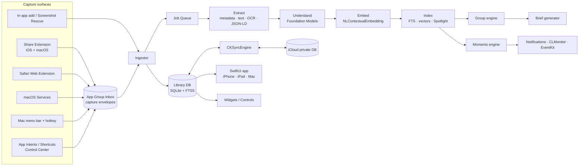
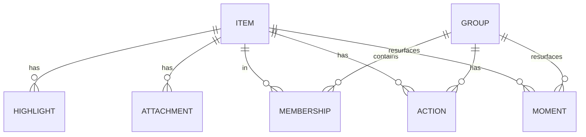
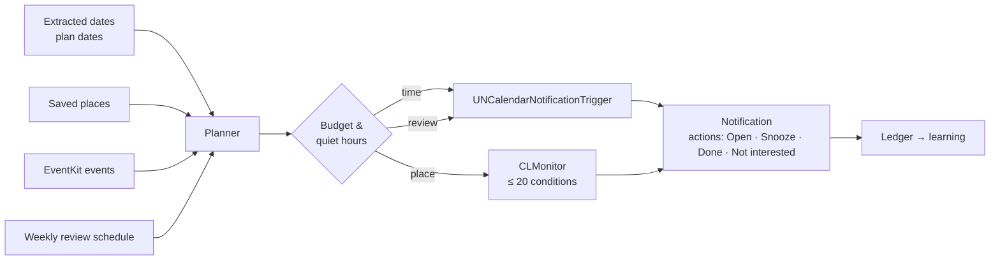

# Nextmark — Architecture

Requirement IDs (C1, U2, M3…)
refer to `prd.md`.

Goals:
- capture must be **instant and crash-proof**, even when the main app isn't
  running
- all intelligence is **on-device first**, behind protocols, and degrades
  gracefully
- **no server of ours**: CloudKit for sync, Apple models for AI
- one SwiftUI codebase for iPhone, iPad and Mac; extensions stay small
- every AI output is **re-generatable** (versioned pipeline), and user edits
  are never overwritten

AI-session capture, digests, workstreams and Recap are specified in
`ai_sessions_spec.md`. The additions below (§4.2 and §5.1) are reserved in
1.0 so that work is purely additive.

Platform baseline: iOS / iPadOS / macOS 26, Swift 6 (strict concurrency),
SwiftUI, Swift Testing. OS 27 features are behind `#available`.

---

## 1. System overview



The architecture rests on three ideas:

1. **Capture is decoupled from processing.** Every capture surface writes an
   immutable *capture envelope* to the App Group container and exits. Only
   the main app (or its background tasks) touches the database and the AI.
2. **Enrichment is a persistent, versioned job pipeline.** Each stage is
   idempotent and records the version that produced its output. That lets
   us re-run stages when a model or prompt improves, resume after the app is
   killed, and let any device do the work.
3. **Source facts and derived data are separate, and user edits are a
   third layer.** Sync carries all three; precedence is
   `user > derived > source`.

---

## 2. Targets

| Target | Platforms | Purpose | Links |
|---|---|---|---|
| **App** | iOS, iPadOS, macOS | Main UI, ingestor, enrichment, sync, Moments, MenuBarExtra (Mac), Services provider (Mac) | all packages |
| **ShareExtension** | iOS, macOS | C1, C3: intent chips, note, group picker → envelope | `Model`, `Capture`, `CaptureUI` |
| **SafariExtension** | iOS, macOS | C2/C7: JS content script and native handler → envelope; highlight re-render | `Model`, `Capture` |
| **WidgetsExtension** | iOS, macOS | Next Actions widgets, Control Center control (C10, A4) | `Model`, `LibraryRead` |
| **Tests** | all | unit, integration, prompt evals | — |

Mac-only capabilities (Services, menu bar, hotkey, ScreenCaptureKit, `message://`
drag) live in the App target behind `#if os(macOS)`. There's no separate
helper app: the app can run as a menu-bar-only agent ("Keep in menu bar"
setting) and offers *Launch at Login* through `SMAppService.mainApp`.

**Why the share extension doesn't run AI:** iOS share extensions have a tight
memory ceiling (about 120 MB) and the user is waiting. Loading a language
model there risks a jetsam kill, which means a lost save. The extension's
job is to **persist the envelope in under a second** and dismiss.

---

## 3. Capture

### 3.1 Capture envelope

One directory per capture in `AppGroup/Inbox/<ULID>/`:

```
envelope.json      // CaptureEnvelope (below), written last = commit marker
payload/           // raw files: image, PDF, webarchive, .eml, …
```

```swift
struct CaptureEnvelope: Codable, Sendable {
    var id: ULID                       // time-sortable
    var capturedAt: Date
    var device: DeviceID
    var surface: CaptureSurface        // .shareSheet, .safariExtension, .services, .hotkey, .intent, .inApp
    var sourceApp: String?             // bundle id when known
    var url: URL?                      // canonical page / file URL
    var title: String?
    var selection: TextQuote?          // turned into a SelectionAnchor (§3.3) at ingest
    var text: String?                  // selected or shared text
    var pageContext: PageContext?      // lang, JSON-LD blobs, excerpt (Safari)
    var payloadFiles: [PayloadFile]    // relative paths + UTType
    var userIntent: Intent?            // chip tapped in the share UI
    var userNote: String?
    var userGroupID: GroupID?
}
```

Writing `envelope.json` last (atomic rename) makes the operation
crash-safe: the ingestor ignores directories without it and garbage-collects
them after 24 h. The extension posts a Darwin notification so a running app
ingests immediately; otherwise ingestion happens on the next launch,
foreground, or background task.

### 3.2 Surfaces → envelope

| Surface | How | Notes |
|---|---|---|
| Share extension (iOS/macOS) | `NSExtensionActivationRule` predicate for URL, image, text, PDF, file; `NSItemProvider.loadFileRepresentation` to copy files into the payload. | SwiftUI UI hosted in `UIHostingController` / `NSHostingController`. Group picker reads a small `groups.json` snapshot the app writes into the App Group (no DB access from the extension). |
| Safari via share sheet | `NSExtensionJavaScriptPreprocessingFile`: `run()` returns the URL, title, `getSelection()` with prefix/suffix, `lang`, `<script type="application/ld+json">` blobs, and a readable excerpt. | Safari only. Other browsers only provide a URL, and enrichment fetches the page later. |
| Safari Web Extension | Content script for selection UI and highlight re-render; `browser.runtime.sendNativeMessage` → `SafariWebExtensionHandler` writes the envelope. A `contextMenus` item gives a top-level right-click entry on Mac. | The highlight list for a page is read from a per-domain JSON index the app writes into the App Group. |
| macOS Services | `NSServices` entry in Info.plist (`NSSendTypes: public.utf8-plain-text, public.url`; `NSSendFileTypes: public.content` for files in Finder), handled by `NSApp.servicesProvider`. Text arriving with a page URL is stored as a highlight (text-fragment anchor). | Launches the app if needed. A small HUD confirms the save; nothing takes focus. |
| Mac quick capture | `MenuBarExtra` (Quick Capture…, Save Clipboard, Capture Screenshot…) and a global hotkey (⌥⌘S, can be turned off in Settings) via Carbon `RegisterEventHotKey`, which is sandbox-safe and needs no Accessibility permission. The hotkey opens a floating, non-activating panel that reuses the share sheet's `CaptureSheet` (intent chips, note) with a source picker: the **clipboard** (text, links, copied files and images) or a **screenshot** of the display under the pointer via `SCScreenshotManager`, with Nextmark's own windows excluded. Links, files and images can also be dropped on the panel. | Screen Recording permission is requested only when the user first takes a screenshot. Still to come: the frontmost Safari tab (asked from the Safari Web Extension over native messaging; Apple Events to Safari would need a temporary-exception entitlement that App Review resists) and drops onto the menu-bar icon or the Dock. |
| Mail (Mac) | Dropping a message from Mail yields a `message://%3CMessage-ID%3E` URL plus a `.eml` file promise. | Reopens the exact message. |
| App Intents | `SaveItemIntent(url:text:file:intent:)`, `SaveClipboardIntent`, `SaveLatestScreenshotIntent`; a Control Center `ControlWidgetButton`. | Same envelope path, so behaviour is identical everywhere. |
| Screenshot Rescue | `PHAsset` fetch from `.smartAlbumScreenshots`, newest first; bulk import runs as a `BGContinuedProcessingTask` (iOS 26) with system progress UI. Stores `PHAsset.localIdentifier` (`item.sourceAssetID`, never synced) to dedupe and to offer "Clean Up Photos" later. Screenshots from the last 7 days land in the Inbox; older ones go straight to the library and the Screenshots screen, sorted by kind as they're understood. New screenshots are imported on each foreground once a rescue has run. | `ScreenshotImporter` writes items directly (no envelope), in batches of 50, each followed by an enrichment pass. |

### 3.3 Anchors: returning to the exact place (F5)

```swift
enum SelectionAnchor: Codable, Sendable {
    case web(textFragmentURL: URL,              // url#:~:text=prefix-,start,end,-suffix
             quote: TextQuote)                  // W3C TextQuoteSelector: exact + prefix + suffix
    case pdf(page: Int, quote: TextQuote, bounds: [CGRect])
    case mail(messageURL: URL)                  // message://<id>  (Mac)
    case file(bookmark: Data, quote: TextQuote?) // security-scoped bookmark (Mac) / copy (iOS)
    case image(region: CGRect?)                 // optional crop of interest
}
```

The text-fragment URL is used to *open* the page. The `TextQuote` is used to
*re-anchor* highlights in the Safari extension when the page has changed
slightly (fuzzy match on prefix and suffix).

---

## 4. Data model

### 4.1 Storage choice: SQLite (GRDB) + CKSyncEngine, not SwiftData

| Need | SwiftData + CloudKit | **GRDB + CKSyncEngine** |
|---|---|---|
| Full-text search with ranking | ✗ (`#Predicate` `contains` only) | ✓ FTS5 + BM25 |
| Vector storage and fast scans | awkward | ✓ BLOB column + Accelerate |
| Unique constraints, dedupe | ✗ under CloudKit | ✓ |
| Control over conflicts and sync scope | ✗ | ✓ per-record, per-field |
| Shared zones later (G7) | ✗ | ✓ CKShare per group zone |
| Effort | low | medium (≈1–2 weeks extra) |

`CKSyncEngine` (iOS 17+ / macOS 14+) handles scheduling, push, retries and
account changes. We map rows ⇄ `CKRecord`.

### 4.2 Entities



**Item** (synced)
- Identity: `id`, `kind`, `createdAt`, `capturedOn`, `surface`, `sourceApp`, `canonicalURL`, `contentHash`
- **Source facts:** `sourceTitle`, `text`, `anchor`, `pageContextJSON`
- **Derived** (AI and extractors, each with `derivedVersion`): `aiTitle`, `summary`, `imageDescription`, `ocrText`, `kindGuess`, `entitiesJSON`, `typedFieldsJSON` (product/place/event/recipe…), `datesJSON`, `placesJSON`, `suggestedIntent`, `language`
- **User layer:** `userTitle`, `note`, `intent`, `status` (`inbox · active · done · faded · trashed`), `pinned`, `editedFields` (bitset), `lastOpenedAt`

**Highlight**: `itemID`, `anchor`, `quote`, `color`, `note`

**Attachment**: `itemID`, `role` (`original · thumbnail · archive`), `uti`, `byteSize`, `localPath`, `syncPolicy` (`always · ifEnabled · never`)

**Reserved for AI sessions** (`ai_sessions_spec.md` §7): `Item.kind` `.aiSession`, `Item.status` `.log`, `Item.syncScope` (`cloud · local`); `SessionMeta`, `ActivitySpan` (recorded for *every* item from 1.0), `Rollup`, `Recap`; `Group.kind` `.workstream`.

**Group**: `id`, `kind` (`manual · smart · plan · workstream`), `state` (`suggested · accepted · dismissed`), `userTitle`/`aiTitle`, `emoji`, `color`, `goal`, `targetDate`, `briefJSON`, `briefVersion`, `briefInputsHash`, `status`

**Membership**: `groupID`, `itemID`, `origin` (`user · ai`), `score`, `locked`. A membership the user creates or confirms is locked, and the AI never removes it.

**Action**: `id`, `itemID?`, `groupID?`, `title`, `dueAt?`, `status`, `origin` (`user · aiSuggested · aiAccepted`), `reminderID?` (EventKit calendarItemIdentifier, per device)

**Moment**: `id`, `target` (item/group), `trigger` (`date(Date) · place(lat, lon, radius) · calendar(eventID) · review`), `state` (`scheduled · delivered · dismissed · acted`), `deliveredAt`

**Local only (never synced; rebuilt on demand):** `item_fts` (FTS5),
`embedding(itemID, modelID, vector BLOB)`, `group_centroid`, `job`,
`notification_ledger`, `place_monitor_set`, and the sync bookkeeping
(`syncChange`, `syncStamp`, `syncMetadata`, `syncOrphan`, `syncState`,
`syncControl`).

### 4.3 Sync rules

- One custom zone `Library` in the private database; later, one zone per
  shared group (G7).
- One `CKRecord` per row: `Item`, `Group`, `Membership`, `Action` and
  `Attachment`. The record name is `<type>:<key>` (a membership's key is
  `groupID/itemID`; an attachment's is `itemID-index`, the same on every
  device). All columns travel in one `encryptedValues` field, so the
  content is end-to-end encrypted. The merge runs on the device, so the
  server never needs to read it.
- Record fields map 1:1 to the three layers. **Conflict policy:**
  - The user layer is last-writer-wins per field. Every local edit
    stamps the time of that field in `syncStamp`. The stamps travel with
    the record as `syncFieldTimes`.
  - For the derived layer, the **higher `derivedVersion` wins** (also
    `extractVersion` and `briefVersion`). On a tie, the later write wins.
  - Timestamps (`updatedAt`, `lastOpenedAt`) keep the later value.
  - Source facts are written once.
  - Merging is deterministic, so a merge equal to the server's copy sends
    nothing back.
- **Change tracking:**
  - SQLite triggers record every local insert, update and delete in
    `syncChange`, one row per record, with a sequence number. They also
    write the field stamps.
  - The stamps live in their own table, never in the row: a trigger that
    updates `item` would run before the full-text index's trigger and
    corrupt the index.
  - Records being applied from the server set a flag, so they are not
    recorded and sent back.
  - A send clears only the change it carried, so an edit made while a
    record was in flight still goes up: after each send, every change still
    waiting is handed to the engine again.
  - Because the triggers do all this, repositories need no sync code.
- **Records from the server** are applied parents first. A membership,
  action or attachment that arrives before its item or group is parked in
  `syncOrphan` until the parent arrives.
- **Deletions:**
  - A local deletion that hasn't been sent yet wins over an incoming edit.
  - An edit saved after another device's deletion recreates the record
    (CloudKit reports the record as unknown, and it is sent as new).
  - Deletions are applied parents first. Memberships are only ever deleted
    with their group (the user deletes or merges it; the AI never deletes
    one), so a membership deletion is always applied.
  - A suggested group's ID comes from its members, so two devices that
    find the same cluster make the same record, and a dismissed one stays
    dismissed.
- **Account and zone changes never delete local data.**
  - Sign-in, a switch of account, or a zone that was deleted or reset
    (encrypted data reset) clears the server state we keep. The whole
    library is then sent again.
  - If the user deletes Nextmark's iCloud data in Settings (`purged`),
    sync turns off until they turn it back on.
- Embeddings aren't synced. They are cheap to recompute, and the embedding
  model can differ between OS versions; `modelID` detects that. Items that
  arrive from another device are embedded on arrival.
- **Cross-device enrichment (U6):** a device with the on-device model
  re-runs Understand on arriving items whose understanding is provisional
  or older. Its result syncs back and wins by version. Extraction stays
  with the device that has the files.
- Attachments: the original file is a `CKAsset`. It travels unless the
  user turns off "Sync Original Files". Turning the setting back on sends
  the files that were left behind. The Extract stage draws a 600-pixel
  JPEG thumbnail of images and of a PDF's first page (`<itemID>-thumb`,
  `syncPolicy = always`), so every device can show one. A web archive
  syncs only on Pro with the setting on.
- Items with `syncScope = local` (and their memberships, actions and
  attachments) never leave the device.
- **Enrichment lease (not built yet):** today two devices with the model
  may both understand the same item. The work is idempotent, so the cost
  is only wasted effort. The planned lease:
  - Before running AI on an item, a device writes
    `enrichLease = (deviceID, expiresAt)` to the record.
  - Other devices skip leased items.
  - Devices with Apple Intelligence advertise `aiCapable` in a small
    `Device` record, so devices without it can leave the work to them.

---

## 5. Enrichment pipeline

### 5.1 Job queue

```swift
struct Job { let itemID: ItemID; let stage: Stage; var attempts: Int; var notBefore: Date }
enum Stage: Int, CaseIterable { case extract, prefilter, understand, digest, embed, index, group, moments, rollup }
// prefilter/digest run only for .aiSession; rollup runs per workstream × ISO week (ai_sessions_spec.md §4–5)
```

- Persisted in SQLite; a single `actor PipelineRunner` drains it with
  bounded concurrency (2 for extraction, 1 for the model).
- Runs when: the app is in the foreground; `BGProcessingTask` (overnight,
  charging); `BGAppRefreshTask` (small batches); during
  `BGContinuedProcessingTask` for bulk imports. On the Mac it runs whenever
  the app or menu-bar agent is alive.
- Backs off on `ProcessInfo.thermalState ≥ .serious` and Low Power Mode.
- Each stage writes its outputs plus `derivedVersion`. Raising a stage's
  version in a release re-enqueues affected items lazily (visible items
  first).

### 5.2 Stages

| Stage | Inputs → outputs | Tech |
|---|---|---|
| **Extract** | URL → title, site name, hero image, canonical URL, readable text, schema.org kind + typed fields; PDF → text per page; image → OCR text, barcodes, classification labels; plain-text file → text. Safari captures use the page as the user saw it (no fetch). | `Extraction` module: `URLSession` (ephemeral, size-capped), tolerant HTML/readability parser, `SchemaOrg`, `PDFKit`, Vision `RecognizeTextRequest`, `DetectBarcodesRequest`, `ClassifyImageRequest` |
| **Understand** | extracted text and/or image → `ItemUnderstanding` | Foundation Models guided generation (§6) |
| **Embed** | title + note + summary + highlight + image description + keywords + OCR + page text (most telling first, cut to the model's length) → unit vector | `NLContextualEmbedding` (mean-pooled), behind `EmbeddingProvider` |
| **Index** | → FTS5 row, vector row, `CSSearchableItem` + `IndexedEntity` | GRDB, Core Spotlight, App Intents |
| **Group** | vector → suggested membership / suggested new group | §7 |
| **Moments** | dates, places, plan dates → `Moment` rows → OS schedulers | §8 |

Extract stage rules:
- Network: only the saved URL is fetched, with an ephemeral session (no cookies),
  15 s request timeout and a 3 MB cap (25 MB for PDFs and images). Offline, timeouts
  and 429/5xx are retried with backoff; other failures extract what they can. If
  retries run out, Understand still runs on the captured facts.
- Facts never overwrite captured data: a page title only fills a missing
  `sourceTitle`. A schema.org kind is stored as `structuredKind` and wins over the
  model's guess in Understand.

Embed stage rules:
- `NLContextualEmbedding` has one model per script (Latin, Cyrillic, CJK…), picked
  from the text's dominant language. Each vector is stored with its model ID
  (`identifier#revision`) and is only compared with vectors from the same model, so
  semantic search works within a script; full-text search covers the rest.
- Model assets download on demand. Until they arrive, Embed jobs back off and
  retry; text in an unsupported script is skipped (no retry). At launch, items
  without a vector, or with one from a model an OS update replaced, are queued again.
- Vectors are local only (`embedding` table, never synced) and are recomputed
  whenever Understand runs again.

### 5.3 Fallback matrix

| Capability | OS 27 + Apple Intelligence | OS 26 + Apple Intelligence | No Apple Intelligence |
|---|---|---|---|
| Image description | on-device model with image `Attachment` | OCR + labels → text model writes the description | OCR + labels (template text) |
| Summary / kind / entities | on-device model | on-device model | schema.org + heuristics; **deferred to an AI-capable device** if the user has one |
| Group naming / Brief | on-device; PCC for large groups | on-device, map-reduce | keyword-based names ("Kyoto · 9 items"); Brief deferred |
| Embeddings / search | ✓ | ✓ | ✓ (`NLContextualEmbedding` doesn't need Apple Intelligence) |

`SystemLanguageModel.default.availability` is checked on every launch.
`modelNotReady` re-queues the work rather than failing it.

---

## 6. Intelligence layer

### 6.1 Interfaces

```swift
protocol ItemUnderstander: Sendable {
    func understand(_ input: UnderstandingInput) async throws -> ItemUnderstanding
}
protocol GroupBriefWriter: Sendable {
    func brief(for input: BriefInput) async throws -> GroupBrief   // title, goal, date + item digests
}
protocol EmbeddingProvider: Sendable {
    func embed(_ text: String) async throws -> TextEmbedding   // unit vector + model ID (one model per script)
    func isCurrent(_ modelID: String) async -> Bool             // false once an OS update replaced the model
}
protocol QueryInterpreter: Sendable {          // F2 natural-language filters
    func interpret(_ query: String, now: Date) async throws -> SearchQuery
}
```

Implementations: `FoundationModelsUnderstander`, `VisionHeuristicUnderstander`
(fallback), `FakeUnderstander` (tests). The `IntelligenceRouter` picks one per
call from availability, OS version, input size and user settings. The
Foundation Models `LanguageModel` protocol (OS 27) leaves the door open to a
user-supplied cloud model later without changing these interfaces.

### 6.2 Guided generation types

```swift
@Generable struct GeneratedUnderstanding {          // Intelligence/FoundationModelsUnderstander.swift
    var title: String                               // ≤ 8 words
    var summary: String                             // 1–2 sentences
    var kind: GeneratedKind                         // article, product, place, event, recipe, …
    var likelyIntent: GeneratedIntent               // why the person most likely saved it
    @Guide(.maximumCount(8)) var keywords: [String]
    var imageDescription: String                    // photos and screenshots only
    @Guide(.maximumCount(5)) var dates: [GeneratedDate]    // evidence (quoted) + ISO date + role
    @Guide(.maximumCount(5)) var places: [GeneratedPlace]  // name as written + address
}

@Generable struct GroupBrief {
    var title: String
    var overview: String
    @Guide(.maximumCount(5)) var keyPoints: [String]
    @Guide(.maximumCount(3)) var openQuestions: [String]
    @Guide(.maximumCount(4)) var suggestedActions: [SuggestedAction]
}
```

Rules:
- **Facts from structure first.** schema.org data (prices, dates, addresses)
  fills typed fields deterministically; the model only fills gaps. Its kind wins
  over the model's, and its dates and places come first (`FactMerge`).
- **Grounding.** A model date is kept only if its quoted evidence appears in the
  source and states that day (checked with `NSDataDetector`); a model place only
  if its name appears in the source (`Grounding`). Dates create notifications,
  so a wrong one is worse than a missing one.
- **Small, narrow prompts.** One session per task and no long chats, to stay
  well inside the **8,192-token on-device context**. Inputs are cut to token
  budgets (`TokenBudget`: CJK characters count as whole tokens), with the saved
  date and item type in the prompt so year-less dates resolve. A context
  overflow retries once at 40 % of the budget.
- **Provisional results.** The heuristic fallback's results are stored as
  `derivedVersion = 0`; when the on-device model is available, items below the
  current Understand version are queued again (`requeueStaleUnderstanding`).
- **Map-reduce for Briefs.** Item digests are about 60 tokens each (title,
  summary, typed fields). A group under roughly 80 items fits on-device in one
  pass. Larger groups are chunked, or sent to **Private Cloud Compute**
  (32K context) on OS 27, which is free to developers below 2M first-time
  downloads, with no keys and no stored prompts.
- **Brief regeneration** happens only when `briefInputsHash` (sorted member
  IDs + their `derivedVersion`) changes, debounced by 10 minutes.
- **Guardrail errors** (`guardrailViolation`, an overflow after the retry,
  unsupported language) fall back to the heuristic path and never block the item.

### 6.3 Ask (F4)

Retrieval: hybrid search (§9) → top 12 item digests plus highlights → a
session with instructions to answer **only** from the provided items and to
cite item IDs. On OS 27 the system Spotlight search tool can be given to the
model as a `Tool` for follow-up retrieval. Answers render citations as
tappable item chips.

---

## 7. Group engine

All similarities are computed in a **centered space** (`GroupSpace`): the
library's mean vector is subtracted before cosine, because mean-pooled
sentence vectors share a large common component that makes even unrelated
texts look similar. Thresholds below are starting values, tuned on the eval set.

- **Assignment (online, Group stage):** after Embed, a new item is compared
  with each accepted, active group's centroid (mean of its members' centered
  vectors). At ≥ τ_assign (0.6) it becomes a **suggested membership** that the
  user keeps or removes on the group screen; otherwise it stays in the Inbox.
- **Discovery (batch):** after each pipeline pass, at most every 30 minutes:
  agglomerative clustering (average linkage, Lance–Williams updates) over
  items from the last 90 days that are in no group, not even a suggested one
  (up to 400). Merging stops below τ_cluster (0.5); a cluster of 3–40 items
  becomes a **suggested group** named by `TopicNamer` (the keyword or title
  word most members share), later renamed by its Brief. At most 3 per pass.
  Dismissed suggestions keep their member set; a cluster overlapping one by
  Jaccard ≥ 0.6 isn't proposed again.
- **Stability:** memberships the user creates or confirms are locked; one the
  user removes stays as `excluded`, so the AI never re-adds it. Accepted groups
  are never split or renamed automatically (`userTitle` always wins).
- **Briefs (PRD G3):** written for accepted groups when the hash of their
  confirmed members (IDs, `derivedVersion`, notes) plus title and goal
  changes, once the group hasn't changed for 10 minutes; "Write Brief Again"
  skips the wait. The on-device model writes overview, key points, open
  questions and undated next steps; dated next steps come only from the items'
  own dates (`ActionSuggester`), so a deadline is never invented. Without the
  model, a heuristic brief is stored as version 0 and rewritten when the model
  becomes available (`requeueStaleBriefs`).
- **Actions (PRD A1, A2, A5):** `ActionSuggester` proposes next steps from intent,
  kind and dates (buy → "Buy … before the sale ends", event → "Go to …", recipe →
  "Cook …"); the user adds one with a tap. Dismissed suggestions are stored and
  not offered again. Checking off the last open action of an item or group
  offers to mark it done, with an optional outcome note.
- **Scale:** 10k items × ~512–768 floats ≈ 20–30 MB. Brute-force similarity
  takes milliseconds, so no ANN index is needed for v1.
- **Typed-group detection (later):** if ≥ 70 % of members share a kind with
  typed fields, the group offers **Compare** (G4) and the matching view (G5).

---

## 8. Moments engine



- **Planner** recomputes after every pipeline pass, on launch, after a
  notification is answered and when settings change. It is deterministic and
  unit-tested with a fake clock (`MomentGenerator` → mute filter → `MomentPlanner`
  → `UserNotificationScheduler`, all in the `Moments` module).
- **Time (M1):** one Moment per item, from its next upcoming date: an event the
  evening before at 18:00 (or 3 hours before when it was saved too late for
  that), a deadline or sale end the morning before at 10:00, a reservation 3
  hours before (or 9:00 that day). Plans come back 5 days before their date,
  then the day before, with their item and open-action counts. Actions are due
  at 9:00 on their day. Wording is absolute ("Ends Saturday, Nov 21"), so it
  stays true whenever the notification is read. iOS allows 64 pending local
  notifications per app; the planner keeps the nearest 40 and recomputes as
  they fire. Moment notifications have stable identifiers (`moment.<reason>.<id>`),
  so a reschedule replaces rather than duplicates them; snoozed ones are kept.
- **Answers:** Open (goes to the item, group, Next Actions or the review),
  Mark as Done (action, item or group), Remind Me Tomorrow (9:00 the next day)
  and Not Interested; swiping a notification away counts as dismissed. Each
  answer is written to the local `notificationLedger`.
- **Weekly Review (M2):** at the chosen weekday and hour (default Sunday
  18:00), when there is something to review: up to 15 items with a date in the
  next 14 days or open actions, then this week's new saves, then items not
  opened for 30 days. The user swipes or taps Do (adds a next step), Keep or
  Toss (undoable).
- **Place (opt-in):** `CLMonitor` with `CircularGeographicCondition`. At most
  20 conditions per app, so the planner monitors the 19 nearest saved places
  plus one "refresh" region around the user's current area. Leaving that
  region triggers a reshuffle. Needs *Always* location permission, which is
  requested only from the Place Moments setting, with a clear explanation.
- **Calendar (opt-in):** EventKit full access. Upcoming events are matched to
  groups by embedding the event title and location against group centroids,
  plus explicit plan dates.
- **Budget (M5):** a default of 3 Moments per day (1–6 in Settings), quiet
  hours (default 22:00–8:00; Moments falling inside move to the end), and per-type
  dismissal learning: a type is muted for 30 days after 3 dismissals in a row.
  Notification permission is asked the first time there is something to schedule.
  Notification actions are handled in the app delegate without opening the
  app (Snooze, Done).

---

## 9. Search

Query flow: `QueryInterpreter` (optional, when the model is available) turns
"pdfs about tax from last week" into `SearchQuery(text: "tax", kinds: [.document], dateRange: …)`.
Then:

1. **Lexical:** FTS5 `MATCH` with BM25 over title, summary, note, highlights,
   OCR, description, keywords and domain. Uses the `unicode61`
   tokenizer, plus character trigrams for CJK languages.
2. **Semantic:** embed the query and run a cosine scan over vectors from the
   same model that pass the structured filters. A vector counts as a match only
   above a floor (0.5) *and* within a band (0.12) of the best match: mean-pooled
   vectors of unrelated texts are still fairly similar, so without the band every
   item would match. Both values are tuned on the eval set. If the query can't be
   embedded (assets missing, unsupported script), search uses keywords alone.
3. **Fusion:** Reciprocal Rank Fusion (k = 60) of the two lists, then a small
   recency boost (half-life 30 days) and intent and pinned boosts, sized to
   reorder close calls only. Done and faded items rank lower (× 0.7).

Filters (`SearchQuery`): content kind and capture kind (one facet, combined with
OR: "photos or products"), intent (the user's, else the suggested one), status
(default: everything but trashed), saved date range and site. With filters but no
text, search lists the matching items newest first. Code: `Library`
(`ItemRepository+Search`: FTS, vectors, filters as SQL) and `Search`
(`HybridSearch`, `SearchRanking`).

Target: p95 < 100 ms at 10k items on an A15. Results stream as they arrive:
lexical first, then the fused list.

---

## 10. App structure and code organization

The Xcode project is generated by XcodeGen from `project.yml` (8 targets:
app, Share, Safari and Widgets × iOS/macOS) and is not committed.

```
├─ project.yml                # XcodeGen spec — the source of truth for targets and settings
├─ Makefile                   # make open · make test · make build-ios · make build-macos
├─ App/
│  ├─ Shared/                 # @main NextmarkApp, AppModel (composition root), assets, privacy manifest
│  ├─ iOS/                    # Info.plist, entitlements
│  └─ macOS/                  # Services provider, menu bar, hotkey, quick capture panel, screenshots, HUD
├─ Extensions/
│  ├─ Share/                  # iOS + macOS ShareViewController, PageCapture.js (Safari preprocessing)
│  ├─ Safari/                 # Resources/ (manifest, background.js, content.js) + SafariWebExtensionHandler
│  └─ Widgets/                # Next Actions widget (reads a JSON snapshot, never the DB)
└─ Packages/NextmarkKit/      # local Swift package, one library per module
   ├─ Sources/
   │  ├─ Model/               # value types, ULID, Intent, ItemKind, anchors, envelope — no dependencies
   │  ├─ Capture/             # EnvelopeStore, ShareItemLoader, TextFragment, InboxWatcher (extension-safe)
   │  ├─ CaptureUI/           # CaptureSheet + CaptureDraft (extension-safe, SwiftUI)
   │  ├─ DesignSystem/        # intent chips, symbols, tints
   │  ├─ Library/             # GRDB schema v1, records, Item/Group/Action repositories, JobQueue, Ingestor, SyncCatalog
   │  ├─ Extraction/          # Extract stage: page fetch, HTML metadata, readable text, schema.org, PDF text, Vision
   │  ├─ Intelligence/        # understanders, brief writers, ActionSuggester, TopicNamer, router, EmbeddingProvider
   │  ├─ Pipeline/            # PipelineRunner actor
   │  ├─ Search/              # HybridSearch (FTS + vectors + RRF), SearchRanking, vector math
   │  ├─ Grouping/            # GroupSpace (centering), assignment, discovery (clustering)
   │  ├─ Moments/             # MomentGenerator, MomentPlanner (budget, quiet hours), notifications
   │  ├─ Sync/                # SyncStore (records, merge, orphans), CloudSync (CKSyncEngine delegate)
   │  ├─ Integrations/        # Photos (Screenshot Rescue); later EventKit, Spotlight, App Intents
   │  ├─ Store/               # StoreKit 2: Pro products, entitlements (ProAccess), Free tier limits
   │  └─ Features/            # SwiftUI screens: sidebar, Inbox, Next Actions, groups, item, Search, Settings
   └─ Tests/                  # Swift Testing, one target per module
```

Still to come: `Tests/PromptEvals`.

**Pro (PRD P4).** `ProAccess` reads `Transaction.currentEntitlements` at launch
and listens to `Transaction.updates`. A current entitlement means Pro: one of
our products, not revoked, not upgraded away, and (for a subscription) not
expired. The answer is cached in `UserDefaults` so the app opens with the
right features before StoreKit replies. Products: `com.nextmark.app.pro.monthly`
and `.yearly` (one subscription group) and `.lifetime` (non-consumable). They
are universal purchases. `App/Nextmark.storekit` tests them locally from the
generated schemes.

Free never limits capture, search, the library, sync or the Weekly Review.
Pro adds:
- **Moments:** date, plan and due-action reminders. Without Pro,
  `MomentSettings.includesTimeMoments` is off and only the review is scheduled.
- **Briefs:** the pipeline writes none without Pro, and the group screen
  explains what they are.
- **Unlimited smart groups:** `acceptSuggestion(smartGroupLimit:)` throws
  `GroupLimitReached` past 3 active smart groups. Manual groups are never
  limited.
- **Later:** Compare, Ask, Reminders sync and archiving, each gated as it ships.

Dependency rule: `Model` ← `Capture` ← extensions. Extensions link only
`Model`, `Capture`, `CaptureUI` and `DesignSystem`, and **never** import
`Library`, `Intelligence` or `Sync`; that keeps their binary size and
memory small. Feature modules depend on protocols that the App target
injects through a small environment-based container.

Third-party dependencies: **GRDB** only. Everything else is first-party.

---

## 11. UI architecture

- SwiftUI with `@Observable` view models per screen; data flows from GRDB
  `ValueObservation` into `AsyncSequence`s.
- Navigation: `NavigationSplitView` on iPad and Mac (sidebar: Inbox, Next
  Actions, Groups, Plans, Kinds, Faded); `TabView` with a search tab on
  iPhone.
- Mac: multiple windows (open a group in its own window), full keyboard
  control, Quick Look on attachments, drag items out as URLs/files.
- Item detail renders by kind (link card, image with description and OCR
  toggle, PDF page with highlight, product card…).

---

## 12. Privacy and security

- Data protection class `completeUntilFirstUserAuthentication`, so background
  tasks can run after the first unlock.
- No third-party SDKs; a privacy manifest declares required-reason APIs
  (file timestamps, UserDefaults). App Store label: **Data Not Collected**.
- Network access only for: fetching saved pages (enrichment and archive),
  iCloud, StoreKit, and PCC through the system framework.
- Permissions are requested in context only: Photos (Screenshot Rescue),
  Location *Always* (Place Moments), Calendars/Reminders (Calendar Moments /
  Reminders sync), Screen Recording (Mac screenshot capture), Notifications
  (first Moment).

---

## 13. Testing and quality

- **Unit:** envelope round-trip, anchor and text-fragment builder, schema.org
  parser, RRF fusion, clustering thresholds, Moment planner (fake clock and
  locations), conflict resolution.
- **Integration:** in-memory GRDB plus a fake `CKSyncEngine` transport
  (two-device simulation), and a pipeline with `FakeUnderstander`.
- **Prompt evals (`Tests/PromptEvals`):** a golden set of about 200 captured
  pages and screenshots with expected kind, intent, dates and places. Runs on
  a Mac with Apple Intelligence; reports accuracy per field. A prompt or model
  change must not regress any field by more than 2 points.
- **Performance budgets** (`XCTMetric` tests, run on a physical device before each release):
  share extension commit < 500 ms; item enrichment < 3 s on device; search
  p95 < 100 ms at 10k items; cold launch < 400 ms to the first frame of the
  Inbox.

---

## 14. Build order

1. `Model`, `Capture`, share extension → envelopes on disk *(week 1–2)*
2. `Library` + ingestor + Inbox/Library UI + FTS search *(3–4)*
3. `Pipeline` Extract + Vision; `Intelligence` Understand; Embed + hybrid search *(5–7)*
4. Mac surfaces: Services, menu bar, hotkey *(8)*
5. `Grouping` + Briefs + Actions + Next Actions *(9–10)*
6. `Moments` (time and review) + notifications *(11)*
7. `Sync` (CKSyncEngine) *(12–13)*, built: records, merge, two-device tests
8. Screenshot Rescue onboarding, StoreKit, polish, TestFlight *(14–16)*;
   built so far: onboarding, Screenshot Rescue, thumbnails, Pro (StoreKit 2)

Risks to spike in week 1: Foundation Models output quality on the golden
set (go/no-go for AI-first UX); the share extension's memory with large
images; CKSyncEngine record mapping.
